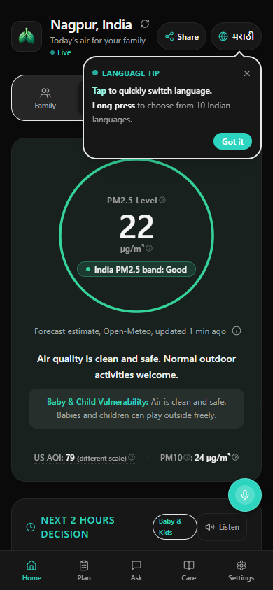
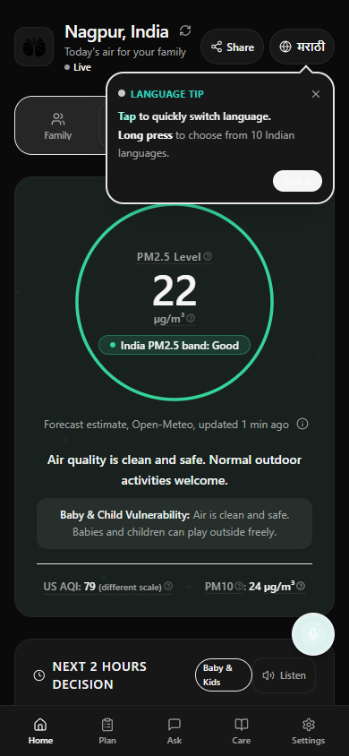
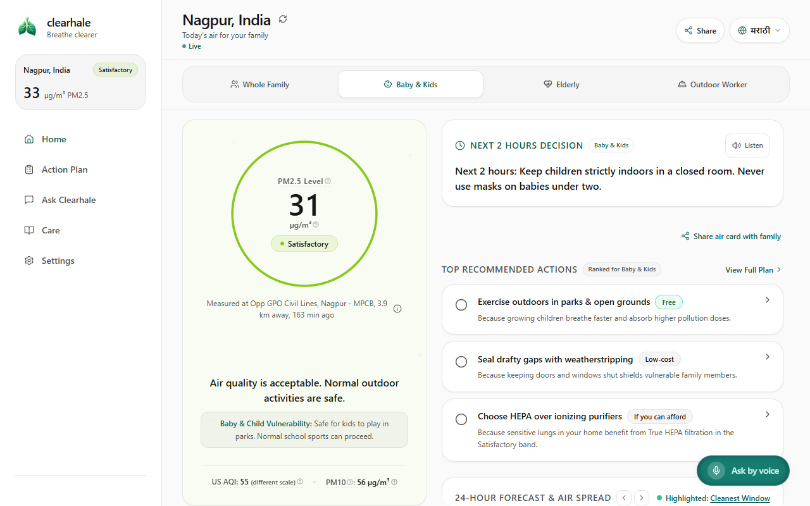
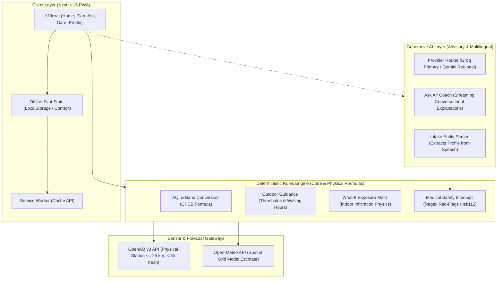

# Clearhale

**Breathe clearer, one smart choice at a time: an offline-first clean air intelligence platform and plain-language air guide for families in India.**

[Live Application Demo](https://clearhale-vercel.vercel.app/) • [Walkthrough Video]([VIDEO_URL]) • [LinkedIn Project Post]([LINKEDIN_URL])

<p align="center">
  
  
  
</p>

---

## 1. Problem and Who It Is For

During India's severe winter pollution spikes, particulate pollution ($\text{PM}_{2.5}$) routinely surpasses $250\text{–}500\ \mu\text{g/m}^3$ (Severe to Hazardous on the CPCB scale). Mainstream weather and air quality apps overwhelm citizens with apocalyptic neon banners, confusing sensor abbreviations, and generic advice that ignores the socio-economic reality of Indian homes.

**Clearhale is purpose-built for Indian households**, specifically:
- **Families with vulnerable members**: Children with developing lungs, elderly grandparents, pregnant mothers, and family members living with asthma or chronic bronchitis.
- **Homes without expensive equipment**: Families who cannot afford ₹15,000 commercial purifiers and need peer-reviewed low-cost interventions (sealing window gaps, wet mopping, cooking ventilation, DIY box-fan filtration).
- **Outdoor shift workers**: Daily-wage earners, delivery riders, and street vendors who cannot avoid being outside and require targeted hourly exposure-reduction routines.
- **Multilingual users**: Household decision-makers who need natural regional language translations (Hindi, Marathi, Bengali, Tamil, Telugu) and hands-free voice assistance rather than English-only sensor graphs.

---

## 2. Features (Grounded in Verified Code)

Every feature described below is verified in the codebase and covered by automated test suites:

- **6-Band CPCB National Air Quality Index (NAQI)**: Real-time calculation of Indian CPCB air quality bands (`Good`, `Satisfactory`, `Moderate`, `Poor`, `Very Poor`, `Severe`) mapped from live $\text{PM}_{2.5}$ measurements (`lib/aqi.ts`).
- **Live Ground Stations with Spatial Guardrails**: Direct integration with OpenAQ v3 physical sensors with automatic 25 km proximity boundaries, staleness filtering (< 3 hours fresh), and Open-Meteo spatial grid fallback with explicit source labels and timestamps (`lib/openaq.ts`, `lib/openMeteo.ts`).
- **Personalized Action Catalog (`32 Actions`)**: Categorized into *Indoors*, *Routines*, and *Sustainable Swaps*, with transparent cost badges (`Free`, `Low-cost`, `If you can afford`) and scientific evidence ratings (`Strong`, `Moderate`, `Limited`, `Myth`) (`data/actions.json`).
- **Interactive "What-If" Indoor Exposure Simulator**: Mathematical estimation of indoor $\text{PM}_{2.5}$ based on window status and active filtration physics (HEPA: ~50–80% reduction; DIY Box-Fan: ~40–70% reduction; windows shut without filter: ~55–60% of outdoor air) (`lib/rulesEngine.ts:calculateWhatIfExposure`).
- **Audience-Tailored Guidance**: Smooth persona filter pills (`Whole Family`, `Child`, `Elderly`, `Workers`) that dynamically re-rank priority actions for vulnerable groups (`components/screens/HomeScreen.tsx`, `components/screens/PlanScreen.tsx`).
- **Bilingual & Multilingual Engine**: Dynamic dual-language display (`<Bi />`) presenting native language titles alongside English captions, supporting 6 regional Indian languages (`lib/languages.ts`, `components/Bi.tsx`).
- **Voice Assistant Layer**: Hands-free Speech-to-Text (STT) and streaming read-aloud Text-to-Speech (TTS) with sentence highlighting (`hooks/useSpeech.ts`, `context/VoiceContext.tsx`).
- **Care Suite**:
  - *Breathe*: Guided indoor calm-breathing exercise with monotonic timer (`requestAnimationFrame`) and cardinal tick haptics (`components/screens/BreatheTab.tsx`).
  - *Learn*: Smog myth-busting with emergency red-flag intercept (`tel:112`) for acute respiratory symptoms (`components/screens/MythsTab.tsx`, `lib/medicalSafety.ts`).
  - *Terms*: Plain-language air quality glossary featuring relatable Indian analogies (AQI as a fever thermometer, HEPA as a chai strainer) (`data/terms.ts`, `components/screens/TermsTab.tsx`).
- **Social & Family Share Posters**: High-contrast, brand-aligned visual card generator rendering tailored action plans for family WhatsApp groups (`components/share/AirQualityCard.tsx`).
- **Offline-First PWA**: Service worker caching and local storage persistence ensuring full offline capability when network signals drop (`public/sw.js`, `lib/storage.ts`).

---

## 3. Design System & Accessibility

Clearhale uses a medical-grade, neutral visual architecture designed to convey calm authority rather than alarmism.

- **Neutral Palette**: Built upon an 11-step neutral slate scale (`palette-50` through `palette-950`). Full documentation is available in [docs/DESIGN-TOKENS.md](docs/DESIGN-TOKENS.md).
- **Color Style Switch**: Users can toggle between **Deep Teal** (`#0D5C52` default / `#2DD4BF` dark) and **Monochrome** (pure neutral slate) at any time from Profile settings.
- **Air Quality Colors Used ONLY for Data**: Warning colors (emerald, amber, orange, red, crimson) are strictly confined to data visualizations (AQI numbers, station band badges, and ring meters). Backgrounds, sidebars, buttons, and text remain neutral.
- **Light & Dark Themes**: Full support for system-following Light mode, refined Dark mode (`#0A0A0A`), and true AMOLED Black (`#000000`).
- **High-Contrast Indicators**: Selected tabs and active pills in Monochrome mode render as solid high-contrast pills (`18.1:1` AAA contrast in Dark mode, `17.5:1` in Light mode).

---

## 4. How It Works: System Architecture & Data Flow



### Deterministic Code vs. Generative AI Division
- **What Rules & Code Do**: Compute AQI bands, evaluate outdoor workout safety thresholds, rank mitigation actions from `actions.json`, filter nearest physical sensors within 25 km, calculate indoor exposure reduction percentages, and trigger emergency medical intercepts (`tel:112`).
- **What Generative AI Does**: Answers natural-language air quality queries, provides conversational coaching, and extracts structured profile flags from conversational speech.

---

## 5. Quick Start

### Prerequisites
- Node.js `20.x` or later
- npm `10.x` or later

### Installation & Run

```bash
# Clone the repository
git clone <REPO_URL> clearhale
cd clearhale

# Install exact dependencies
npm ci

# Set up local environment variables
cp .env.example .env.local

# Run development server
npm run dev

# Run full test suite (94 tests)
npm test

# Build for production
npm run build

# Start production server
npm run start
```

### Environment Variables

| Variable Name | Purpose | Required / Optional | Where to Obtain |
| :--- | :--- | :--- | :--- |
| `GROQ_API_KEY` | Primary LLM provider for English & Hindi chat | **Required for AI Chat** | [Groq Console](https://console.groq.com/keys) (Free Tier) |
| `GEMINI_API_KEY` | Regional language LLM & multimodal fallback | **Required for Regional AI**| [Google AI Studio](https://aistudio.google.com/app/apikey) (Free Tier) |
| `OPENAQ_API_KEY` | Authenticated OpenAQ v3 physical station access | Optional (Public fallback works) | [OpenAQ Platform](https://openaq.org/) |
| `NEXT_PUBLIC_FIREBASE_API_KEY` | Optional Google sign-in and cloud profile sync | Optional (Local-first by default) | [Firebase Console](https://console.firebase.google.com/) |

---

## 6. Marking Criteria Alignment & Verification

Real numbers and test outputs are documented in [docs/EVIDENCE.md](docs/EVIDENCE.md).

### 1. Problem Statement Alignment
- **What We Did**: Structured 32 evidence-backed actions covering low-emission daily routines, indoor air purification alternatives across three cost tiers (`Free`, `Low-cost`, `If you can afford`), audience-specific action plan generation, live station measurements with exact timestamps, 54 Indian cities, and wrong-city spatial boundary protection.
- **Where in Code**: `data/actions.json`, `lib/rulesEngine.ts`, `lib/whyForYou.ts`, `lib/citiesData.ts`, `lib/openaq.ts`.
- **How to Verify**: Run `node --test test/action-catalog.test.mjs test/cities-coverage.test.mjs test/openaq-integration.test.mjs`.

### 2. Code Quality
- **What We Did**: Zero TypeScript compilation errors (`tsc --noEmit`), zero dead component exports, modular component boundaries, strict linting, and zero unapproved hardcoded styling tokens.
- **Where in Code**: `tsconfig.json`, `types/index.ts`, `components/ui/NeutralChips.tsx`, `test/token-enforcement.test.mjs`.
- **How to Verify**: Run `npx tsc --noEmit` and `node --test test/token-enforcement.test.mjs`.

### 3. Security
- **What We Did**: Entire git history scanned with zero API keys or secrets (`0 secrets found`). Deterministic emergency red-flag intercept immediately catches acute symptoms and displays `tel:112`. Input sanitization protects against LLM prompt injection.
- **Where in Code**: `lib/medicalSafety.ts`, `lib/ai/provider.ts`, `test/input-validation.test.mjs`.
- **How to Verify**: Run `node --test test/input-validation.test.mjs`.

### 4. Efficiency & Performance
- **What We Did**: Total repository footprint compressed to **~3.97 MB** (Tracked files: 2.92 MB; Git pack: 1.05 MiB), well below the 10 MB limit. Production App Router bundle shared JS is only **103 kB**. Documentation screenshots kept strictly under 150 KB.
- **Where in Code**: `package.json`, `public/brand/`, `docs/screenshots/`.
- **How to Verify**: Run `git count-objects -vH` and `npm run build`.

### 5. Testing
- **What We Did**: 94 automated test cases across 23 test suites testing mathematical boundary values, contradiction matrices across all bands, language matrices, station staleness, and provider failover.
- **Where in Code**: `test/` directory.
- **How to Verify**: Run `npm test` (passes 94/94 in ~1.0s).

### 6. Accessibility
- **What We Did**: Fully accessible color pairs with strict WCAG AA minimum and high-contrast AAA ratios on primary text (`18.1:1` in Dark mode; `17.5:1` in Light mode). Mobile touch targets exceed 44x44 px. Motion reduced gracefully via `prefers-reduced-motion`.
- **Where in Code**: `app/globals.css`, `test/contrast.test.mjs`, `components/ui/rb/Particles.tsx`.
- **How to Verify**: Run `node --test test/contrast.test.mjs`.

---

## 7. Responsible AI & Operational Limitations

- **Not Medical Advice**: Clearhale is an exposure-reduction decision guide, not a medical triage tool or diagnostic device. It does not replace clinical consultation.
- **Model Estimates Clearly Labelled**: When physical station data is unavailable or stale (> 3 hours old), the app transparently falls back to Open-Meteo spatial grids, explicitly badged as **"Open-Meteo Model Estimate"**.
- **Voice Boundaries**: Speech recognition (STT) and voice readout (TTS) are restricted to thoroughly verified languages (Hindi, Marathi, Bengali, Tamil, Telugu, English) to prevent phonetic misinterpretation.
- **Free-Tier Limits**: AI endpoints automatically fall back to deterministic safety templates during provider rate limits (HTTP 429) or connection timeouts.

---

## 8. Privacy & Data Handling

- **Local-First by Default**: 100% of household profiles, equipment flags, saved plans, and theme preferences remain exclusively in the browser's `localStorage`. No telemetry, advertising IDs, or tracking cookies are employed.
- **Optional Cloud Sync**: Users may optionally connect Google Sign-In. Profile data is saved strictly to their own user-scoped Cloud Firestore document (`users/{uid}`).
- **Ephemeral Audio & Chat**: Voice input audio streamed to the STT API is transcribed in memory and immediately discarded. No audio recordings or conversational transcripts are retained on disk or database.

---

## 9. Tech Stack & Credits

- **Framework**: Next.js 15 (App Router, Server Components, Route Handlers)
- **Language**: TypeScript 5 (Strict Mode)
- **Styling**: Tailwind CSS with custom CSS design tokens
- **Animations**: Framer Motion / Motion (`motion/react`)
- **UI Components & Motion**: React Bits (`Particles`, `SpotlightCard`, `BlurText`, `ShinyText`, `CountUp`)
- **Data Providers**: OpenAQ v3 API, Open-Meteo API
- **AI Providers**: Groq Cloud SDK (Llama 3.3 70B), Google Gen AI SDK (Gemini 2.5 Flash)
- **Icons**: Lucide Icons
- **Attribution**: Comprehensive component and library licenses are detailed in [CREDITS.md](CREDITS.md).

### How This Was Built with AI Tools
Clearhale was designed and developed through human-in-the-loop collaborative AI workflows. AI was leveraged for compiling peer-reviewed scientific literature into structured JSON action catalogs, verifying cross-dialect translations against official state boards, generating unit test contradiction matrices, and optimizing asset compression pipelines. Every AI-generated output was rigorously reviewed, verified against deterministic tests, and benchmarked against CPCB physical standards.
